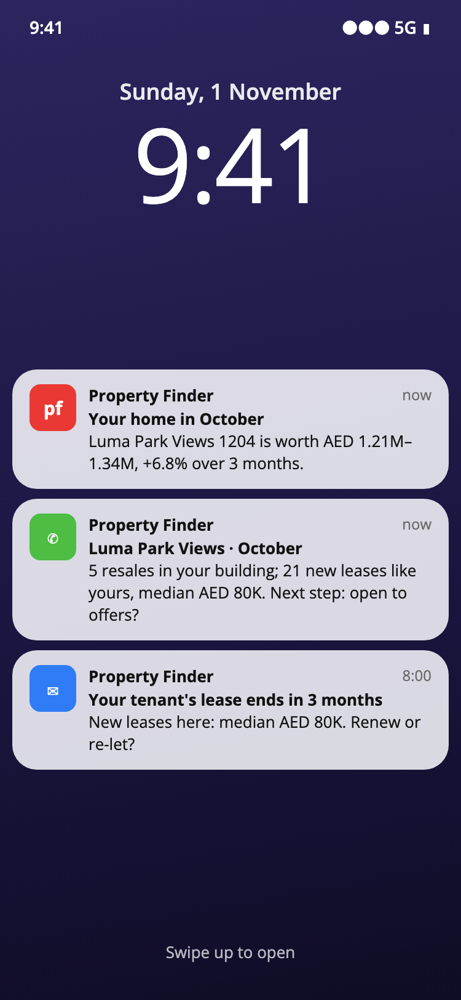
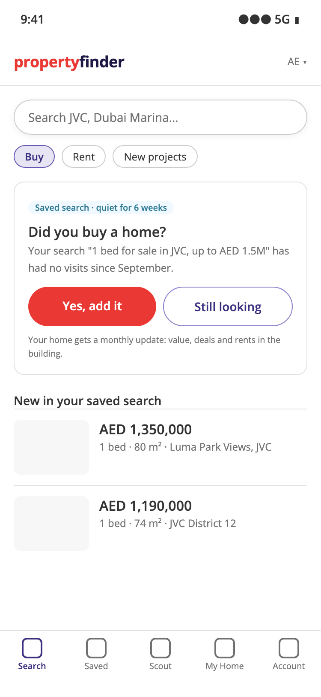
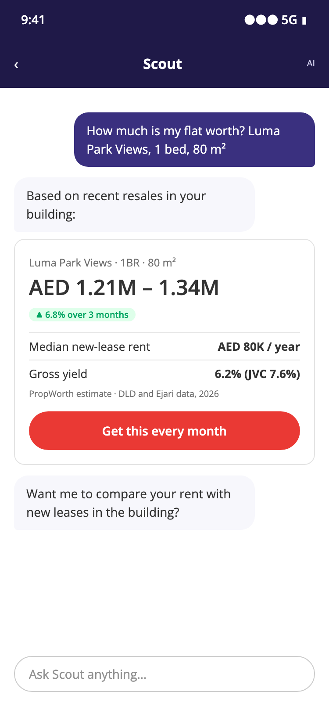
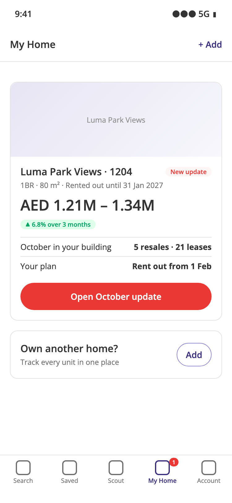
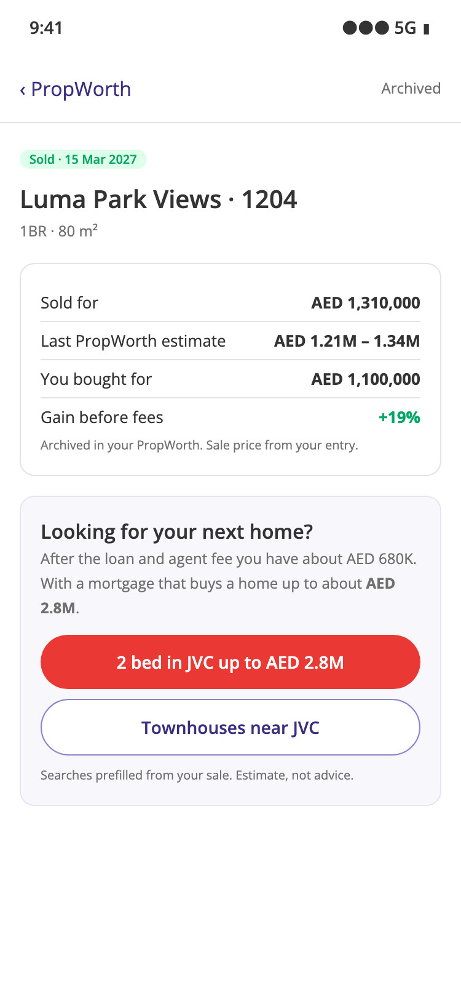
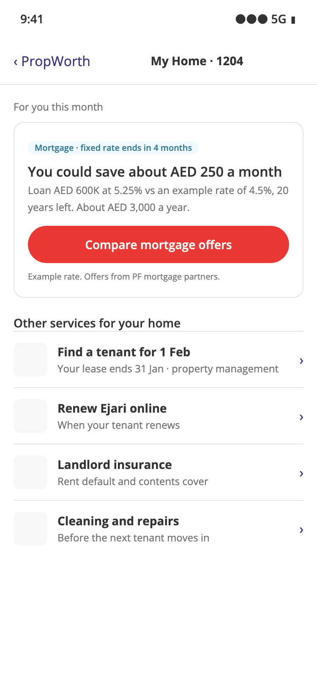

# PropWorth "My Home" prototype (Property Finder)

**Live prototype (open on a phone): https://test-propertyfinder.vercel.app**

**Google Drive (docs, walkthrough deck, screenshots): https://drive.google.com/drive/folders/1iel6pnXt46kyz_A2b9AzEoKaM-Ai8UVP**

After the PropWorth valuation, a unit becomes **My Home**: a monthly update on rents, deals and demand in the building, plus one next step. The owner's intent ("rent out from / open to offers from / not now") becomes a qualified lead for agents and an "owner-confirmed" signal for renters. Renters get Rent watch and a renewal check; buyers get a fair-price and bank-gap check that turns into My Home with one tap.

Business case: `ONE-PAGER.md`. Dev spec: `docs/SPEC.md`.

## Run
```bash
npm install
npm run dev      # http://localhost:3000
npm test         # Vitest: lib, real-data checks, route smoke tests, events API
```
Python data tests: `python3 -m unittest discover -s tests -t .`

## Click-through
- `/` is one screen: the promise and one action each for owners ("Get your PropWorth estimate"), renters ("I rent") and buyers ("Buying a resale?"); with saved homes the main button opens your PropWorth and a summary card appears.
- **Owner:** search "Luma" → 1BR, 80 m² → valuation with "What this means" and a price chart → **Get this every month** (pinned at the bottom) → My Home with tabs: Update (next step and plans first, then the October 2026 numbers, latest alert, settings), Analysis, News (market moves and building news), Owners. **PropWorth** (`/propworth`): all your homes, total value, rent, yield, what needs attention, "Add a home". Back returns to the screen you came from.
- **Renter** (`/rent`): Rent watch and what to do, allowed increase, owner-confirmed units, rent vs buy → `/buy`.
- **Buyer** (`/buy`): fair price, negotiation advice, bank valuation gap → **I bought this** → valuation prefilled.
- `/entry-points` (not linked from the app, open it by URL): sketches of where My Home would appear on other Property Finder screens; why each hook works is below.
- **Pilot: one building (Luma Park Views).** Other JVC buildings are shown as "coming soon" and cannot be chosen.
- **Demo prefill:** every form opens with demo values (`lib/demo.ts`) so you can click straight through; all fields are editable. Consent boxes are pre-ticked only for the demo: a real product never pre-ticks consent.
- **Return and leads (spec section 14):** owners choose WhatsApp / email / in-app and a frequency when they save their home (changeable on My Home) and see the WhatsApp version of the update; renters get renewal reminders and units that free up when their lease ends, each with a viewing request; buyers get mortgage pre-approval and "ask an agent". Numbers and news never mix: market moves and building news live in the News tab.
- **Also on My Home:** "How we estimate" (method, what the estimate cannot know, independence line); event alerts as push / WhatsApp / email previews; a Golden Visa line worded to DLD's rule (purchase value of AED 2M+, so "may qualify" only on the price paid); refinance as the next step for owners with a loan. Renters see taken units as "Let agreed".
- **Reset demo:** the "Reset demo" link in the footer (or `/?reset=1`) clears everything the prototype saved on the device; use it between testers on one phone.
- **Sanity checks:** inputs must be plausible for a JVC home (rent AED 10K–2M a year, prices AED 100K–50M, loan ≤ price paid, lease end not in the past, dates within 2–5 years); the message shows under the field. Out-of-range values in shared links are ignored.

## Where My Home would appear
Hooks on existing Property Finder screens (sketched at `/entry-points`) and why each one works:
- **Listing page, unit for sale in the building** — "Own a flat in Luma Park Views? See what yours is worth". Owners browse listings in their own building to guess their value. Give them the real number from deals.
- **Transactions tab, recent deals** — "Own one here? Get deals like this for your unit every month". People who read transactions are already tracking prices. One tap turns a one-off look into a monthly habit.
- **PropWorth result (today's valuation)** — "Get this every month". The valuation is a one-off today. The monthly update gives a reason to come back.
- **Account tab in the app** — "My Home: add the home you own". A permanent home in the app for owners, next to their searches.
- **Rent search results in JVC** — "Already renting in JVC? Check if your rent is fair before renewal". Renters near renewal compare prices here. Answer the question they actually have.
- **Mortgage calculator on a resale listing** — "Will the bank value it at the price? Check before you offer". Buyers fear a low bank valuation. After the deal the same check becomes their home's value.

### Beyond the site: design mockups (not built)
Static concepts for the entry points that bring owners back without them opening the site first (source: `docs/mockups/entry_points.html`, re-render with `docs/mockups/render.sh`). Numbers match the prototype's October 2026 update for Luma Park Views 1204.

| Monthly push, WhatsApp, email | "Did you buy?" on a quiet saved search | Scout answers with My Home | My Home as an app tab |
|---|---|---|---|
|  |  |  |  |

- **Monthly push, WhatsApp, email**: the update comes to the owner on the 1st of the month; this is what makes the visit monthly. The lease-end reminder arrives 3 months before the tenant's lease ends.
- **"Did you buy?"**: a saved search that goes quiet for weeks usually means the search ended in a deal. One tap turns the buyer into a My Home owner, so the search does not end at the purchase.
- **Scout**: owners already ask the assistant what their home is worth; the answer is a PropWorth card with "Get this every month".
- **My Home tab**: a permanent place in the app next to Search and Saved, with a badge when the new update is out.

After the purchase, the same approach covers the end of ownership and the money around the home (spec section 22):

| Sold → search again | Home services in My Home |
|---|---|
|  |  |

- **Sold → search again**: a sale archives the home in PropWorth (sale price vs the last estimate) and opens the next search, prefilled with the budget the sale frees up. A sale starts the next search instead of ending the relationship.
- **Home services**: one offer at a time, tied to the owner's dates: refinance when the fixed rate ends (about AED 250 a month on the demo loan at an example 4.5% rate), finding a tenant, Ejari renewal, landlord insurance, repairs. Partner offers with revenue share; not built.

## Data
Real public data: Dubai Land Department resales and Ejari contracts for JVC, 1 Jan – 20 Nov 2026 (`dataset/`).
- Resales only: ready units, procedure "Sale" (off-plan, Delayed Sell and lease-to-own excluded).
- "This month" = **October 2026**, the last full month.
- **Hero building Luma Park Views is newly handed over**: 414 of 415 Ejari contracts are first lettings, so there are no renewals in the building yet; renewal checks use JVC-level contracts.
- Ejari rarely has bedrooms, so rents are compared by size (±15%).
- Unit number is stored but not used: DLD open data has no unit numbers.
- Renters can pick any JVC building (Ejari covers all of JVC); the one-building pilot applies to owners.

## Real vs mocked
| Real (DLD / Ejari) | Mocked |
|---|---|
| Estimate and range, deal lists, outlook, rents, Rent watch, RERA proxy, yield, bank gap, rent vs buy, "What this means" readings, price chart, deal / lease news items | Demand block (labelled "Illustrative"), editorial news (tower, school, road works, service charge) and owners' posts (labelled illustrative), waitlist, the agent who gets a request and its status (Sent → Accepted → Viewing), digest and alert delivery by push / WhatsApp / email (My Home shows what would have been sent), renter reminders, viewing / mortgage / buyer requests, title deed verification, leads (stored in the browser, nothing sent), owner-confirmed units (synthetic listings), mortgage rate (example 4.5%, editable), owner statuses of the owner-confirmed units (demo), the refinance saving (example rate) |

## Calculation notes
- Estimate: median AED/m² of comps in the last 3 months × size, range P25–P75. Fallback: same building any rooms → JVC same rooms; confidence drops to low.
- Outlook: JVC trend May–Jul vs Aug–Oct (the same windows as the momentum reading), annualised; ±5 pp, low end −5 pp more for supply risk; clamped to −20% / +15%. On the snapshot: about −8% to +7% a year. (A Jan–Mar base sat on a high January and pinned the range at −20%.)
- Same-day bulk deals (same date, building, price and size) count as one comparable and show as "same-day bulk deal (N units)".
- The value change in the monthly update is over 3 months, not month on month (monthly noise).
- RERA index proxy: **median** of all JVC contracts of the size band (new + renewed). The mean is unusable: Ejari has outliers from AED 50 to AED 9M a year. The official calculator uses DLD's own index; ours is a proxy.

## Not built
- **P1** (no entry point yet): break / move / negotiate calculator (R6), "I think it's worth" (O4), "Something wrong?" report and Help page (C4, H3), mock sign-in (C5), one monthly update for all homes (W15), tracking a home outside the pilot with the owner's own value (P5, P6). The portfolio (O5) is built as `/propworth`. Notification settings (O7: channel and frequency on My Home) and contact about an owner-confirmed unit (R5: "Request a viewing") are built.
- **P2**: real title deed verification, real lead delivery, real email / WhatsApp, Arabic and RTL, move-out and deposit, areas beyond JVC and other markets, real PF demand data, Rent in 12, pay-per-deal matching with DLD / Ejari, history before 2026 (needs a Dubai Pulse key).
- Optional LLM wording of the digest was skipped; everything is deterministic.
- **Not built from spec v13–v15**: "Your building this week" from PF listings (L1), alert when the value crosses AED 2M (G2), "your dates this month" (D1 dates), and the remaining design-review items D4, D6, D8, D9, D11, D12 (link colour of advice lines, chevrons on cards, "No increase allowed" wording, top-bar rules, last instruction strings such as "Tap a unit to request a viewing", pinned save button in the sheet). In the click-through the demo owner statuses do not change, so the "a unit you asked to view is now let" notice is covered by tests only.
- **Known gaps**: two people claiming the same unit (resolved by title deed verification, not built); real sign-in; Scout answering with My Home is a mockup only, no LLM in the prototype; real partner offers and revenue share.
